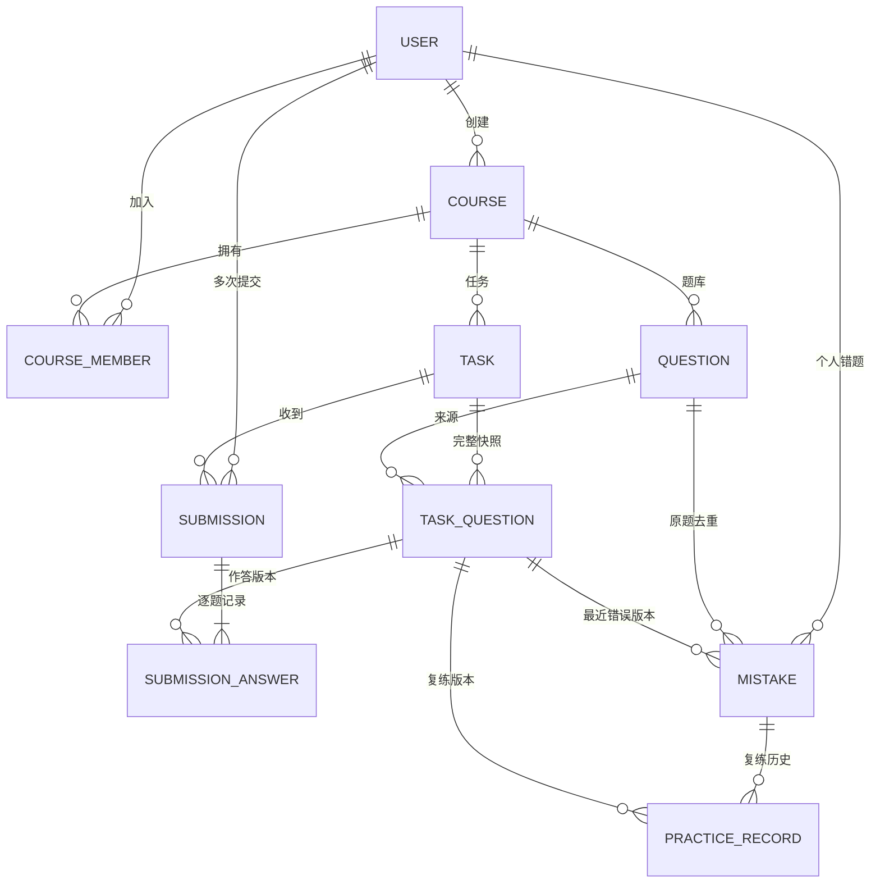

# 数据库设计基线

基线日期：2026-11-11；物理建表脚本更新日期：2026-11-20。以下为逻辑设计；账号表 SQL 位于 [001_auth_schema.sql](../backend/sql/001_auth_schema.sql)，其余九张业务表位于 [002_learning_schema.sql](../backend/sql/002_learning_schema.sql)。物理表统一加 `rw_` 前缀，逻辑表名见下表。[PRD](PRD.md) 定义已确认规则；[未决事项](OPEN_QUESTIONS.md) 约束生命周期设计。

## 1. 分表与 ER
题库原题、任务信息、任务题目完整快照分别存储。快照不是只有两个 ID 的关联表。

USER 的教师创建课程、学生加入并作答，角色约束必须由后端验证。正式历史与复练历史均不可被掌握状态更新覆盖。

## 2. 表与主要字段
主键用 BIGINT；可修改记录带 created_at、updated_at，历史记录保留事件时间。时间精度、时区存储由工程设计统一，展示北京时间，不能用客户端时钟决定截止。

| 表 | 字段及意义 |
|---|---|
| user（物理表 rw_user） | id、username 唯一账号、password_hash BCrypt 安全密码哈希、display_name、student_no 可空、role 固定 TEACHER/STUDENT、status ACTIVE/DISABLED、created_at、updated_at |
| course | id、teacher_id、name、description、invite_code 唯一、status（需能识别归档；生命周期转换待 Q8） |
| course_member | id、course_id、student_id、joined_at；退出及移除字段待 Q8，不提前假设成员永远不能退出 |
| question | id、course_id、type、stem、options_json、correct_answer_json、score、explanation；删除/停用策略待 Q8 |
| task | id、course_id、title、description、deadline_at、status DRAFT/PUBLISHED、published_at、total_score；复制创建新 id 和 DRAFT，不覆盖原任务 |
| task_question | id、task_id、question_id 来源、position 顺序、type、stem、options_json、correct_answer_json、explanation、score；完整独立内容 |
| submission | id、task_id、student_id、received_at 服务器首次接收时间、submitted_at 成功保存时间、attempt_no 同学生同任务成功尝试序号、total_score、correct_count、question_count、idempotency_key、request_hash |
| submission_answer | id、submission_id、task_question_id、answer_json、is_correct、earned_score；漏答用空数组并保存零分记录 |
| mistake | id、student_id、question_id、last_wrong_task_question_id、wrong_count、last_wrong_at、mastery_status UNMASTERED/MASTERED、mastered_at 可空 |
| practice_record | id、mistake_id、task_question_id、answer_json、is_correct、earned_score、practiced_at、idempotency_key、request_hash |

逻辑名 `course`、`course_member`、`question`、`task`、`task_question`、`submission`、`submission_answer`、`mistake`、`practice_record` 对应物理表 `rw_course`、`rw_course_member`、`rw_question`、`rw_task`、`rw_task_question`、`rw_submission`、`rw_submission_answer`、`rw_mistake`、`rw_practice_record`。建表脚本不修改已有 `rw_user` 和测试账号。

分值、任务总分、答卷总分、逐题得分均用 DECIMAL(8,2)，Java 对应 BigDecimal。单题分值大于零且最多两位小数；得分允许零。字段上限为 999999.99，发布时校验总分不溢出；不能通过四舍五入接受非法三位小数。平均分用 BigDecimal 计算，展示舍入约定由工程设计明确，不改变代表答卷选择。
选项如 A→Java、B→MySQL，答案用键数组；判断使用 TRUE/FALSE。JSON 仅保存题内数组，成员、任务、答卷关系使用关联表。

## 3. 唯一约束和索引
- user(username)、course(invite_code) 唯一；重置以事务替换有效码，旧码不再匹配，已有成员关系不变。
- course_member(course_id, student_id) 唯一。
- task_question(task_id, position) 唯一；任务题目以独立快照 ID 标识，工程设计保持选题顺序与逐题计数一致。
- submission(student_id, idempotency_key) 唯一；摘要必须包含目标任务与规范化答案，不能只比较答案文本。
- submission(task_id, student_id) 为普通索引，不能唯一，否则会阻止重交。
- submission(task_id, student_id, attempt_no) 唯一；成功尝试按同一学生同一任务串行分配序号，建议通过事务锁已有成员行完成，不用无锁 MAX+1。
- submission_answer(submission_id, task_question_id)、mistake(student_id, question_id)、practice_record(mistake_id, idempotency_key) 各自唯一。
- 课程教师、成员学生、课程任务、学生错题、错题复练时间等常用过滤字段建立索引；具体组合索引由工程阶段按查询验证。

attempt_no 是落实“最后一次获得最高分”的工程排序设计，同键重试不产生新序号；截止校验仍使用 received_at，不能改用序号或事务结束时间。

## 4. 最高分与统计代表
对同一学生、同一任务：
1. bestScore = 成功正式提交的 total_score 最大值。
2. representativeSubmissionId = 在该最高分答卷中 attempt_no 最大的记录 ID。
3. correct_count 和逐题正确情况必须来自这份代表答卷，不把历次正确题拼成一份答卷。

示例：依次 4、8、6、8 分，最高分 8，代表为第四次，不是第三次，也不是第二次。
统计查询按学生分组后再求平均与正确率；后加入成员计入当前成员分母；复练表不加入正式统计。最高分可查询计算，不必额外建成绩汇总表。

## 5. 发布、提交与错题事务
发布事务校验同课程选题与完整题目内容，保存快照并转为 PUBLISHED。发布后所有任务和题目更新入口检查锁定，不提供延期、撤回；修改题库不会更新快照。复制任务读取原任务内容到同课程新草稿和独立题目副本，保留原题来源，修改新草稿后发布。不得在发布复制草稿时悄悄覆盖教师已修改的内容。
学生作答、判分、结果展示都读取 task_question；question_id 仅追溯和错题去重。草稿选题复制原题内容的具体机制由工程实现，但发布内容应与教师确认的最终草稿一致。

服务器记录接收时间 → 身份权限检查 → 查询成功幂等记录 → 未命中才检查截止、任务状态与参数 → 在一个事务中写 submission、所有 submission_answer、错题更新。并发相同键只有一个事务可成功；冲突重查已成功结果，同键不同内容拒绝；处理中未成功的请求不能伪造成功结果。失败全部回滚。
错题首次正式错误创建为 1、未掌握；再次正式错误及复练错误原子加 1、更新最近错误时间并恢复未掌握。正式答对不修改错题状态或次数；复练答对设置已掌握；手动掌握/取消仅更新状态与 mastered_at。复练历史与错题状态同事务；同键重试不重复更新。
并发错题写入需原子计数或行锁，不能读后无锁覆盖；最近错误时间不能被较早事件覆盖。

## 6. 历史与 P1 边界
题库工程实现（2026-11-21）：沿用现有 `rw_question`，无需迁移。options_json 保存有序的 `[{"key":"A","text":"选项内容"}]`，correct_answer_json 保存 `["A","C"]`，具体输入规则见 [API 设计](API_DESIGN.md)。PATCH 在事务中锁定原题行，合并并校验后仅更新题目内容；不更新 course_id，不写入 rw_task_question。已发布快照隔离已通过真实 MySQL 测试；任务创建与发布接口尚未实现。

所有正式、复练历史和对应题目版本保留；禁止用更新题库或级联删除破坏已有历史。课程、成员、题目、任务具体删除、退出、归档入口和状态策略待 Q8，不把“只停用题目”“归档后禁止复练”等建议当规则。
复练使用最近答错快照是工程建议；每次必须记录实际使用版本，不能用最新题库内容重写历史。
