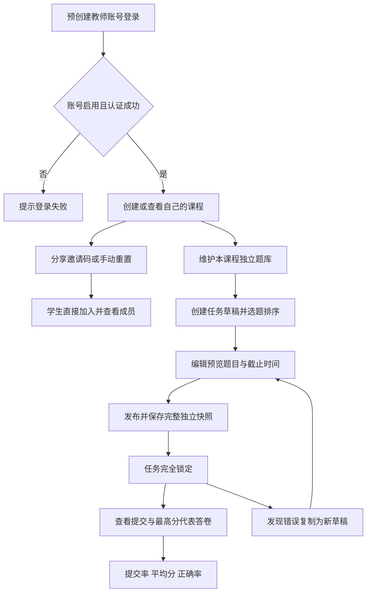
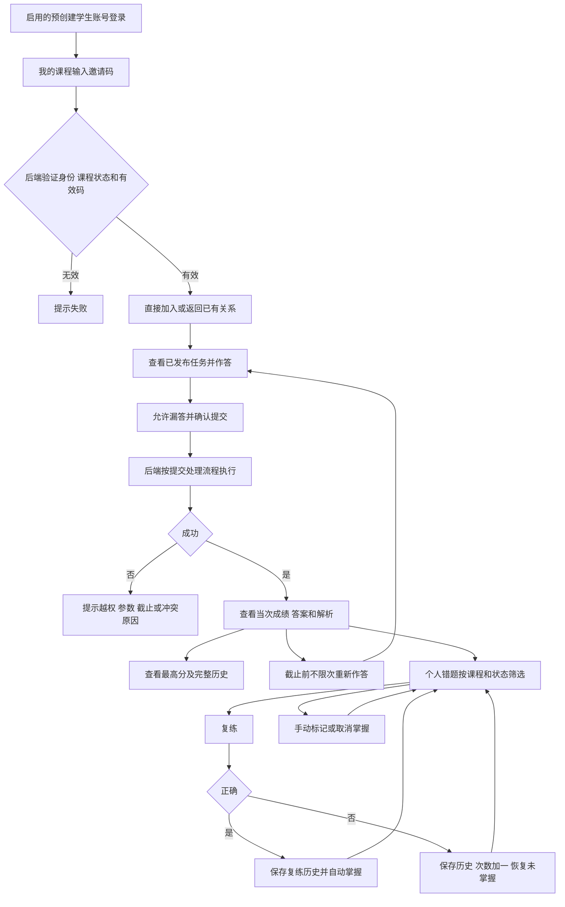
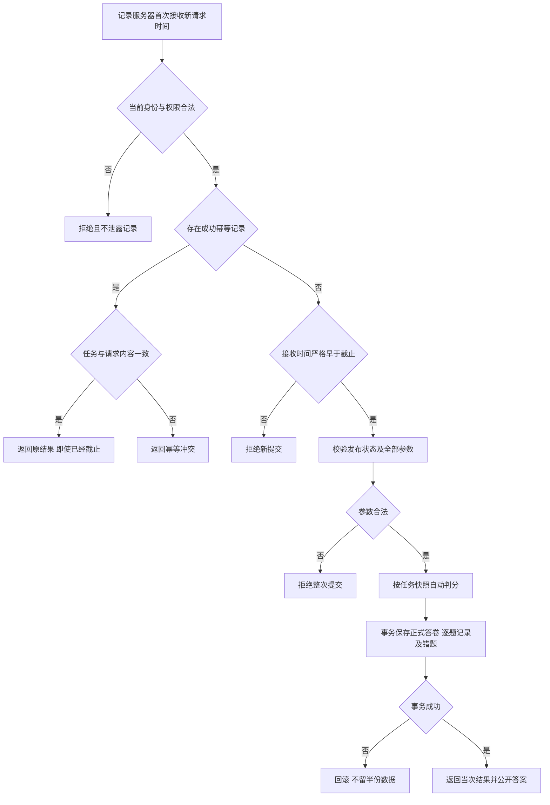

# 业务流程基线

基线日期：2026-11-11。图中为已冻结主流程；生命周期和自动保存仍见 [P1 清单](OPEN_QUESTIONS.md)。

## 1. 教师

发布后不能改题或截止、不能撤回；复制新任务不携带旧答卷。邀请码重置使旧码立即失效，不影响已有成员；归档课程的邀请码失效。

## 2. 学生

正式答对不改变掌握状态；正式答错和漏答新增或更新错题。答案成功提交后已公开，重交继续正常判分。

## 3. 后端正式提交顺序

并发同键通过数据库唯一约束与事务协调，最终仅保存一次；重试不增加错题次数。首次失败回滚不产生成功幂等结果，再次新到达仍校验其接收时间。
最高分与代表答卷按所有成功尝试计算，最高分并列使用最后一次取得最高分者。历史原结果不随后续重交被覆盖。
